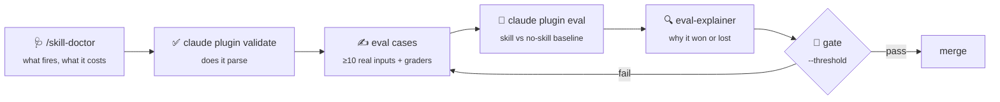
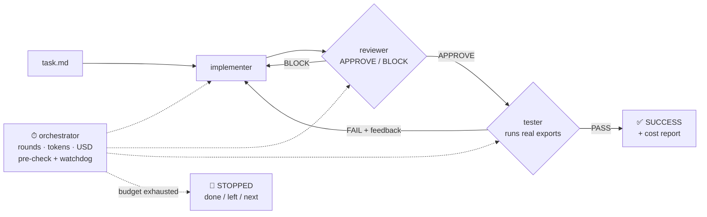

<div align="center">

# Trust, *but eval.*

**From one skill to a team of agents, and how to prove each step actually helps.**

Materials from the talk at **Claude Community Wrocław #4** (20.10.2026) · Konrad Dżbik, CSHARK

[📑 Slides (PDF)](slides/trust-but-eval-ccw4.pdf) ·
[🔍 eval-explainer](https://github.com/CShark-Hub/eval-explainer) ·
[📒 Promptbook](#-promptbook)

</div>

> [!NOTE]
> The demo repo shown on slide 16 is not public. You don't need it: this README has the flow, the
> case format and the prompts to build the same eval for your own skill, and
> [eval-explainer](https://github.com/CShark-Hub/eval-explainer) is public for reading the results.

---

> **An agent you haven't evaluated is just a very confident guess.**
>
> Nobody merges a PR without tests. Why do we merge skills without evals?

## Contents

- [The idea in 60 seconds](#-the-idea-in-60-seconds)
- [The flow: doctor → validate → eval → gate](#-the-flow-doctor--validate--eval--gate)
- [Quick start (15 minutes, your own skill)](#-quick-start-15-minutes-your-own-skill)
- [Promptbook](#-promptbook)
- [Level 4: agent team with a hard budget](#-level-4-agent-team-with-a-hard-budget)
- [Before you ship the next agent](#-before-you-ship-the-next-agent)
- [Numbers from the talk](#-numbers-from-the-talk)
- [Safety notes](#-safety-notes)
- [Official docs](#-official-docs)

---

## 💡 The idea in 60 seconds

### The autonomy ladder

Every level adds autonomy, and one more thing you have to measure.

| Level | What | Adds |
|:-:|---|---|
| **0** | Bare prompt | the **baseline** |
| **1** | Skill | loads on demand |
| **2** | Plugin | skills + commands |
| **3** | Subagent | a reviewer |
| **4** | Agent team | a **budget** and a stop condition |

### Three questions at every level

| | Question | In practice |
|---|---|---|
| 🟠 **Baseline** | Is it better than the level below? | Same input, with and without. No baseline, no claim. |
| 🟣 **Grader** | Who decides what "better" means? | Assertions first, then an LLM judge for the rest, calibrated on human labels. |
| 🟠 **Budget** | What does it cost? | Tokens, dollars and seconds per run, plus a stop condition. |

---

## 🔁 The flow: doctor → validate → eval → gate



These three checks look at different things, and only one of them looks at behaviour:

| Check | Answers | Catches a broken `description`? |
|---|---|:-:|
| `/skill-doctor` | A usage report: what each skill costs in context and how often it gets used. Flags skills that are in the listing but never invoked, plugin skills included. Opens in the `/plugin` **Stats** tab. Needs Claude Code ≥ 2.1.252. | ❌ pass |
| `claude plugin validate .` | Are the manifest and the skill, agent and command files valid (syntax and schema)? | ❌ pass |
| `claude plugin eval .` | Does the skill fire on the prompt and beat the baseline? | ✅ **93% → 0%** |

> [!IMPORTANT]
> **The most dangerous regression passes review.** In the demo, a tidy-up PR shortened the skill's
> `description` (diff +1/−9, body untouched). The skill stopped loading. It fired in 0% of runs
> instead of 93%, and assertions dropped from 64% to 29%, *below* the bare prompt (33%).
> `/skill-doctor` and `validate` both passed it. Only the eval caught it.

---

## 🚀 Quick start (15 minutes, your own skill)

**You need:** Claude Code ≥ 2.1.269 (for `claude plugin eval`), git ≥ 2.31 if git is installed, and
a plugin folder (`.claude-plugin/plugin.json` + `skills/<name>/SKILL.md`). Python 3 is only needed for
the eval-explainer viewer. Every eval run and judge call is a real model call on your plan or API bill.

```bash
claude --version                        # ≥ 2.1.269
git --version                           # ≥ 2.31, if git is installed
cd path/to/your-plugin
```

### 1 · See what you have

Inside a Claude Code session:

```text
/skill-doctor
```

Look for skills that are **never invoked** and for skills with a high cost. Those are your first
eval candidates.

### 2 · Make sure it parses

```bash
claude plugin validate .
claude plugin validate . --strict       # warnings become errors (use this in CI)
```

### 3 · Write cases

Let Claude interview you and draft the suite:

```bash
claude plugin eval init                 # guided: sources inputs, designs graders
claude plugin eval init --bare my-case  # or a blank single-case template
```

A case is a folder: `evals/<case>/prompt.md` plus at least one grader file in `graders/`. Each run
starts in an empty working directory, so put the input (a diff, a file, a ticket) into the prompt
itself. Unknown frontmatter keys are an error.

<details>
<summary><b>Example case</b> (from the demo: commit messages)</summary>

`evals/docs-typo-fix/prompt.md`

````markdown
---
name: docs-typo-fix
description: "looks like a fix, but it's docs"
tags: ["adversarial"]
max_turns: 4
timeout_seconds: 180
allowed_tools: [Skill]
---

I've staged the changes below (output of `git diff --cached`). Write the commit message for them.

```diff
...a real diff from an open-source repo...
```
````

`graders/type.md`: a cheap, deterministic assertion

```markdown
---
type: regex
weight: 2
flags: "m"
pattern: "^(docs)(\\([\\w./-]+\\))?!?: "
---
```

`graders/skill-fired.md`: did the skill load at all?

```markdown
---
type: tool_used
weight: 1
tool: "Skill"
input_match: "\"skill\"\\s*:\\s*\"(?:[\\w-]+:)?commit-message\""
---
```

`graders/quality.md`: an LLM judge with a rubric, for what regex can't see

```markdown
---
type: llm
weight: 2
---

Score 1–5 on type accuracy, description quality and concision, using the anchors below,
then decide PASS/FAIL. ...
```

</details>

**Mix your cases:** mostly happy-path cases, then edge cases (an empty input, unrelated
changes mixed together, breaking changes) and a couple of **adversarial** cases that look like
one thing but are another. Use real inputs, not synthetic ones.

### 4 · Run skill vs baseline

```bash
mkdir -p out

# one case first: cheap smoke test
claude plugin eval . --case my-case --runs 1 --max-cost-usd 1 --no-publish --json out/smoke.json

# the full suite: each case runs with the plugin and without it, on the same prompt
claude plugin eval . --runs 3 -j 8 --max-cost-usd 15 --no-publish --json out/full.json
```

- **Two arms by default.** When a plugin is found, each case runs with it (`WITH`) and without it
  (`W/OUT`). Δ = `WITH` − `W/OUT`, per case. `--ablation none` runs only the with-arm, at half the cost.
- **A "skill fired" check is an indicator, not a score.** In a two-arm run, `tool_used: Skill` graders
  are excluded from the score in both arms, because they can never pass without the plugin. Under
  `--ablation none` they count.
- **Choose the judge.** It defaults to Claude Code's background-task model. Set `--judge-model`
  yourself, to a different model from the one under test (`--model`).
- `--max-cost-usd` is checked before each run starts. Runs already in flight finish, so spend can go
  a little over the ceiling. If any run is left unstarted, the command exits 2 with partial results.
- Put the target (`.`) before `--json`, and give `--json` a path that ends in `.json`.

### 5 · Read *why*

```bash
git clone https://github.com/CShark-Hub/eval-explainer
python3 eval-explainer/serve.py --results path/to/your-plugin --open
```

This gives you an arm comparison, per-case gaps, every grader's verdict with evidence, and cost and
time per run. It runs locally and binds to `127.0.0.1`.

### 6 · Gate the merge

```bash
claude plugin eval . --threshold 0.8    # exit 1 if any case's with-arm score is below 0.8
```

The default `--threshold` is `1.0`: any case below perfect fails. Δ is reported but never changes the
exit code, so gate on the score and read Δ yourself.

Keep `evals/` in the repo next to the skill, and add `evals/results/` to `.gitignore`.
**Test cases are code.**

---

## 📒 Promptbook

Copy-paste prompts for a Claude Code session opened in your plugin folder. Use them in order, or
pick the one you need.

<details open>
<summary><b>1 · Triage: which skills deserve an eval?</b></summary>

```text
Run `claude -p "/skill-doctor"` in Bash (in -p mode it prints the report as text)
and read the report. List every skill with: how often it was used, what it costs
in context, and whether it was never invoked. Then rank the top 3 skills I should
write evals for first, and say why (high cost, never fires, or business-critical).
Don't change any files.
```

Or run `/skill-doctor` yourself, look at the **Stats** tab, and paste what you see.

</details>

<details>
<summary><b>2 · Find the baseline: would the level below be enough?</b></summary>

```text
For the skill <name>, write down what a bare prompt (no skill loaded) would
probably get wrong on this kind of task. Give me 3 concrete failure modes I can
turn into assertions. If you think a bare prompt would do just as well, say so.
```

</details>

<details>
<summary><b>3 · Draft the case set (≥10 real inputs)</b></summary>

```text
Help me build an eval suite for the skill <name> under evals/ (one directory per case).
Source real inputs from this repo's history (e.g. `git log -p`) or from <source>,
not synthetic ones. Aim for ~15 cases: 8 happy path, 5 edge, 2 adversarial
(inputs that look like one category but belong to another).
For each case create evals/<case>/prompt.md with frontmatter
(name, description, tags, max_turns, timeout_seconds, allowed_tools) and the
exact same user prompt wording across cases, only the input differs.
Each run starts in an empty directory, so paste the input into the prompt body.
Phrase the prompt the way a user would type it, without naming the skill.
Show me the list of cases before writing files.
```

Alternative: `claude plugin eval init` runs this interview for you. It needs a terminal, so in CI
use `claude plugin eval init --bare <name>`.

</details>

<details>
<summary><b>4 · Graders: assertions first, judge second</b></summary>

```text
For each case directory under evals/, add graders under graders/:
- regex graders for everything checkable (format, expected type/category,
  required markers, "must not invent output" for empty inputs);
- one tool_used grader that checks the skill <name> actually fired;
- one llm grader (quality.md) with a 1–5 rubric per dimension, anchoring
  examples for 5/3/1, and an explicit PASS/FAIL rule.
Keep regex patterns strict but not brittle. Explain each pattern in one line.
```

</details>

<details>
<summary><b>5 · Smoke run, then the full run</b></summary>

```text
Run `claude plugin validate .` and fix anything it reports.
Then run one case as a smoke test:
  claude plugin eval . --case <id> --runs 1 --max-cost-usd 1 --no-publish --json out/smoke.json
Summarise: did the skill fire, score with vs without the skill, Δ, cost and time.
If it looks sane, run the full suite with --runs 3 --max-cost-usd 15 and give me
a table per case: Δ, which graders failed in each arm, and the cases where the
skill LOSES to the baseline.
```

</details>

<details>
<summary><b>6 · Explain the losses</b></summary>

```text
Open out/full.json. For every case where the skill arm scored lower than the
baseline, or both arms scored 0, show the two answers side by side and the
grader evidence. Tell me whether the fault is in the skill, the case, or the
grader. Propose a fix, but don't apply it yet.
```

</details>

<details>
<summary><b>7 · Regression drill: break the description on purpose</b></summary>

```text
Make a "tidy-up" edit to skills/<name>/SKILL.md: shorten the description to one
plausible sentence that drops the English trigger phrases. Leave the body
untouched. Run:
  claude plugin eval . --ablation none --runs 3 --no-publish --json out/broken.json
Compare skill-fired % and the assertion pass rate with out/full.json.
Then restore the file with `git checkout -- skills/<name>/SKILL.md` and confirm
`git diff` is empty.
```

</details>

<details>
<summary><b>8 · Calibrate the judge</b></summary>

```text
Pick 10 graded answers from out/full.json (mix of judge PASS and FAIL).
Write results/calibration-sheet.md with: case id, the answer, the judge verdict,
and an empty "human:" column for me to fill in. Don't fill it yourself.
After I label it, compute judge-human agreement and list the disagreements.
```

Rule: **the judge is never the same model as the one under test.**

</details>

<details>
<summary><b>9 · Wire it into CI</b></summary>

```text
Add a CI job that, on every change under skills/ or evals/, runs:
  claude plugin validate . --strict
  claude plugin eval . --trust-plugin --json results.json --no-publish \
    --model <model> --judge-model <judge> --max-cost-usd <budget> --threshold <t>
and fails the PR on a non-zero exit (1 = a case below threshold or a run error,
2 = partial run, such as the cost ceiling). Pin both models so a model rollout
isn't mistaken for a regression. Put the models, cost ceiling and threshold in
variables, use ANTHROPIC_API_KEY from CI secrets, and upload results.json as a
build artifact.
```

</details>

<details>
<summary><b>10 · Climb only if the level below isn't enough</b></summary>

```text
I'm considering moving <task> from a single skill to <plugin | subagent | agent team>.
Using out/full.json as the level-1 baseline, design the same eval for the higher
level: same cases, same graders, plus a token/USD/time budget and a stop
condition enforced by a script, not the model. Tell me what result would justify
the extra cost, and what result would mean I should stay at level 1.
```

</details>

---

## 🤖 Level 4: agent team with a hard budget

The second demo: **implementer → reviewer → tester**, with the budget enforced by a script, not
by the model.



```text
$ python3 orchestrator.py --max-iterations 3 --token-budget 160000
[round 1] implementer DONE     28,869 tok | budget 18%
[round 1] reviewer APPROVE     15,759 tok | budget 28%
[round 1] tester FAIL          71,717 tok | budget 73%
[round 2] implementer KILLED   37,700 tok | budget 96%
STOPPED: budget exhausted · 154,045 / 160,000 tok · $0.21 · 56 s
```

What to take from it:

- **The reviewer approved code that was wrong.** Only the tester, running a real CSV export, saw the
  BOM in the header and the blank lines at the end. The task spelled out 8 validation rules and
  said nothing about the export format.
- **Tell the room the stop condition before you run.** A hard budget means the team stops itself and
  reports *Achieved · Remaining · cost per agent · Recommendation* instead of looping forever.
- **Enforce it in code.** A script checks the budget before every round and every call, and a watchdog
  kills a call mid-flight. The CLI's `--max-budget-usd` works only in print mode (`-p`), and the docs
  warn that spend can pass the cap. In our trials it overshot.
- With a generous budget (a 500k-token sample run) the same team succeeded in round 2 for **$0.26 in 79 s**.

---

## ✅ Before you ship the next agent

1. **Do you have a baseline?**
2. **Do you have a grader and ≥10 cases?**
3. **Do you have a budget and a stop condition?**
4. **Would the level below be enough?** ← the one that matters most

> **Rule of thumb:** if one skill meets your quality bar, don't climb higher.

---

## 📊 Numbers from the talk

The `commit-message` skill (Conventional Commits from a staged diff). There were 15 cases: 13 real
patches from vite and commitlint (MIT), one empty diff, and one combined diff. That made 8 happy,
5 edge and 2 adversarial cases. Each case ran 3 times per arm. The model under test was Haiku and
the judge was Sonnet.

| Variant | Assertions pass | Judge PASS | Skill fired | Agent cost / answer | Time / run |
|---|:-:|:-:|:-:|:-:|:-:|
| Bare prompt (baseline) | 33% | 16% | n/a | ~$0.023 | 11.6 s |
| **Skill** | **64%** | 22% | 93% | ~$0.033 | 19.6 s |
| Skill, description "tidied up" | 29% | 9% | **0%** | | 10.7 s |

- **+31 p.p. for about one cent more per answer.** The skill is ~8 s slower because of the extra Skill
  tool round trip.
- **The skill still loses on 2 of 15 cases** (−0.29 and −0.19). Without the eval you would never know.
- **The judge is stricter than regex.** It caught invented "why" text in bodies and types that were
  defensible but wrong.
- The LLM judge (3 votes per answer) was about **¾ of the eval cost**. The full suite (15 × 3 runs ×
  2 arms) took ~3 min and cost ~$10 including the judge.

---

## 🔒 Safety notes

- `claude plugin eval` runs the plugin and its suite **on your machine, as you**. Only evaluate
  plugins you trust.
- If you're signed in with a claude.ai subscription, the HTML report is also **published as a private
  claude.ai artifact**. Add `--no-publish` to keep it local. Runs that a Claude session starts for you
  stay local unless you pass `--publish-report`.
- Runs never stop to ask for permission. Tools beyond the read-only set (`Bash`, `Write`, `Edit`,
  `WebFetch`…) are removed unless you grant them with `--allow-tools`, and a granted Bash runs inside
  the OS sandbox.
- The CLI prints the report's absolute path, which includes your home directory. Crop it out of
  screenshots and recordings.
- `evals/results/` holds raw answers and local paths, so it is gitignored here.

---

## 📚 Official docs

- [Test plugins with evals](https://code.claude.com/docs/en/plugin-evals): `claude plugin eval`, case format, grader types, CI exit codes
- [Measure plugin cost and usage](https://code.claude.com/docs/en/plugins/measure) and [Find unused skills](https://code.claude.com/docs/en/skills#find-unused-skills): `/skill-doctor`
- [Plugin commands reference](https://code.claude.com/docs/en/plugins/cli-reference): `claude plugin validate`, `claude plugin eval init`
- [Extend Claude with skills](https://code.claude.com/docs/en/skills): how a skill's `description` decides when it fires
- [Create a Claude Code plugin](https://code.claude.com/docs/en/plugins/create)

---

## 📁 What's in this repo

```text
README.md                         you are here
slides/trust-but-eval-ccw4.pdf    the deck shown on stage
```

<div align="center">

**Questions? Preferably the uncomfortable ones.**

*Trust, but eval.*

</div>
